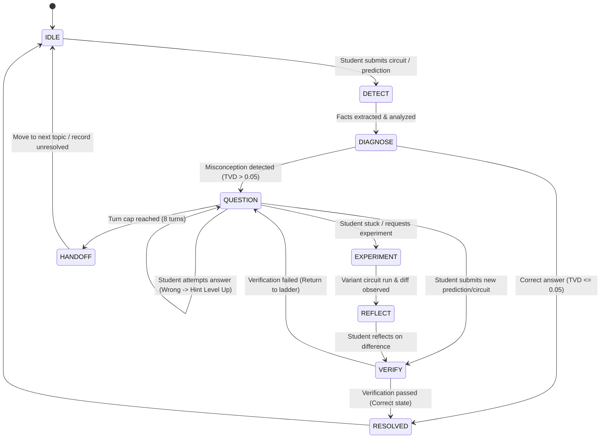

# QUALUTION Misconception Engine - Socratic Loop Architecture

## Overview
The Socratic Loop is a pure, deterministic backend state machine that guides learners from initial observation to misconception resolution through guided Socratic questioning, interactive experimentation, and reflection.

## State Machine Diagram

## State Definitions & Transitions

1. **IDLE**: Initial state. Waiting for student interaction.
2. **DETECT**: Ingests new `learner_event` and extracts quantum physics facts from simulator.
3. **DIAGNOSE**: Runs candidate mutations to rank misconception entries.
   - If TVD <= 0.05 -> Transition to `RESOLVED` (Encouragement turn).
   - If Misconception detected -> Transition to `QUESTION` (Hint Level 1).
4. **QUESTION**: Emits Socratic question based on catalog hint ladder.
   - Hint Level 1: Conceptual orientation.
   - Hint Level 2: Target qubit & gate focus.
   - Hint Level 3: Phase / state vector comparison prompt.
   - Hint Level 4: Explanation & misconception clarification.
5. **EXPERIMENT**: Offers variant circuit comparison (Universe A vs Universe B).
6. **REFLECT**: Prompts student to analyze diff summary (state fidelity, TVD, entanglement).
7. **VERIFY**: Tests updated student submission.
8. **RESOLVED**: Clears misconception status and awards concept mastery points.
9. **HANDOFF**: Triggers when student reaches 8 turns without resolving, or fails Level 4 twice. Saves progress, logs unresolved state, and encourages moving to the next challenge.

## Cross-Lesson Memory Rule
When a student starts a new lesson:
1. `initialize_session_with_memory` queries the learner's persisted `misconception_state` and `concept_mastery` from the evidence store.
2. If any misconception is currently marked `SUPPORTED` (>= 2 touchpoints) and shares relevant concepts with the current lesson, it is registered in `session.prior_supported_misconceptions`.
3. The engine uses this prior supported list to pre-seed the initial probe bias for the first Socratic turn, ensuring that known persistent learning gaps are actively addressed across lessons.

## Hardened Turn Validator Rules
1. **Length Cap**: strictly <= 40 words per turn.
2. **Single Interrogative**: at most 1 question mark, no compound questions (multiple interrogative clauses).
3. **No Outcome or Misconception Leakage**: below Level 4, never state the correct outcome, corrected state, target probability, or misconception name.
4. **Number Grounding**: all numbers must appear in `facts_used` or basis states.
5. **Original Phrasing**: strictly no commercial character catchphrases.

